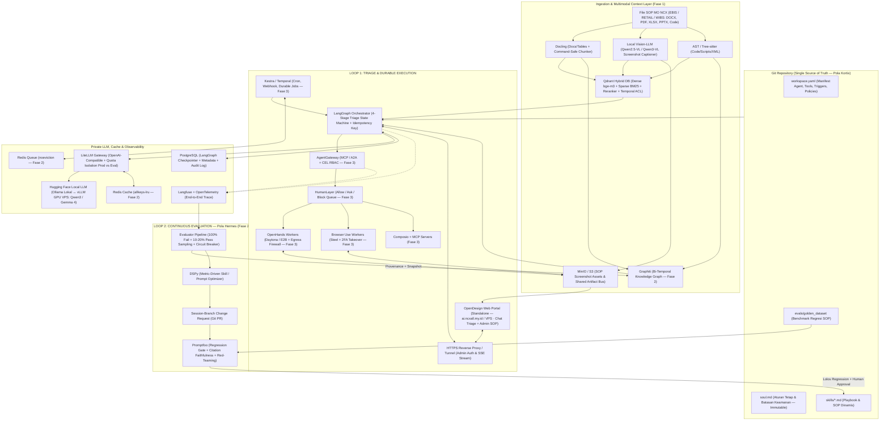
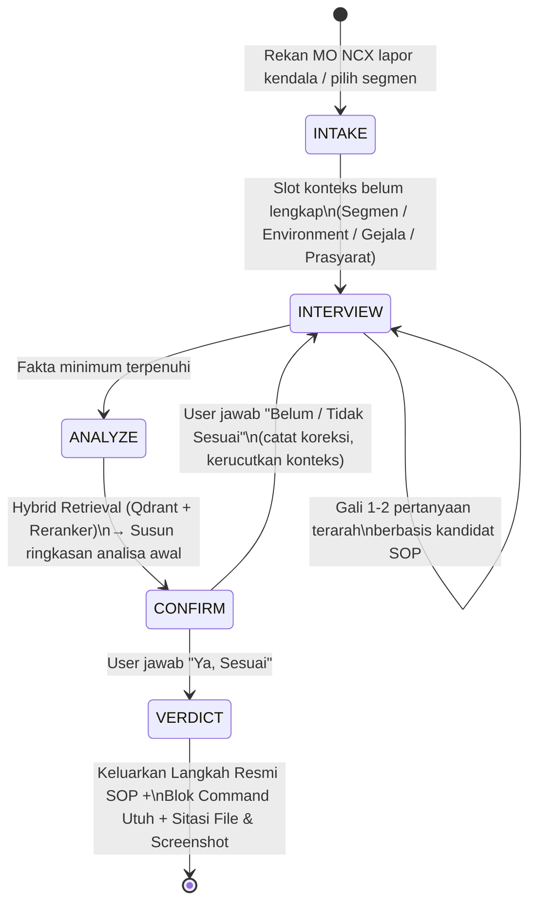

# DESIGN.md — Enterprise Self-Evolving Autonomous AI & SOP Triage Architecture (Design 2.2)

> [!IMPORTANT]
> Dokumen ini merupakan **Design 2.2** — penyempurnaan dari Design 2.1 (adopsi pola terbaik **Kortix AI**, pola *Two-Loop* **Hermes Agent**, dan mitigasi 6 celah kritis *adversarial review*) yang telah di-upgrade untuk:
> 1. **Multimodal Technical SOP Grounding** (teks + CLI/XML utuh + puluhan *screenshot* `before/after` via Vision-LLM lokal).
> 2. **Deterministic 4-Stage SOP Triage State Machine** (*Interview → Analisa → Konfirmasi → Loop Pengerucutan → Vonis SOP*).
> 3. **Qdrant Hybrid Search + Reranker** (Dense `bge-m3` + Sparse BM25 + `bge-reranker-v2-m3`).
> 4. **Standalone OpenDesign Web Portal (`opendesign-web-portal`)** yang berdiri sendiri (mis. `ai.ncxall.my.id` atau langsung dari VPS — terpisah penuh dari `https://ncxall.my.id/dashboard`) dengan protokol SSE Streaming.
> 5. **3-Tier Progressive Rollout** menuju *Autonomous AI* modular berbasis stack *open-source top-star* terbaik per lapisan (**LangGraph**, **Docling**, **Qdrant**, **LiteLLM/vLLM**, **Langfuse/Promptfoo/DeepEval**, **OpenHands**, **Browser-Use**) tanpa ketergantungan vendor tunggal.

---

## 1. Tujuan Arsitektur (3 Pilar Utama)

1. **Multi-File Multimodal Job Context Grounding (Fase 1):** Menyerap dokumen SOP operasional MO NCX (`SOP EBIS`, `SOP RETAIL`, `SOP WIBS` dalam format `.docx`, `.pdf`, `.xlsx`, `.pptx`, dan kode/skrip) termasuk isi *screenshot* konfigurasi *before/after* tanpa kontradiksi antar versi.
2. **Deterministic Triage & Continuous Self-Evaluation — Pola Hermes (Fase 1–2):**
   - **Loop 1 (Execution / Triage):** LangGraph mengunci alur wawancara-analisa-konfirmasi-vonis agar AI tidak pernah menebak solusi di pesan pertama.
   - **Loop 2 (Continuous Evaluation):** Mengevaluasi kualitas jawaban & *skill*, memperbarui memori bi-temporal (**Graphiti**), serta mengajukan perubahan `skills/*.md` lewat **Session-Branch Git PR** yang wajib lolos **Promptfoo Regression Gate** + persetujuan manusia.
3. **Autonomous Multi-Worker Execution — Pola Kortix (Fase 3):** Berkembang menuju eksekusi otonom *end-to-end* (coding sandbox **OpenHands**, otomasi web **Browser Use**, 1.000+ konektor **Composio/MCP**, *durable trigger* **Kestra/Temporal**, serta gerbang `Allow / Ask / Block` **AgentGateway + HumanLayer**).

---

## 2. Diagram Arsitektur

### 2.1 Arsitektur Menyeluruh (Two-Loop System — Design 2.2)



### 2.2 Alur Wajib 4-Tahap SOP Triage State Machine (LangGraph — Fase 1)



---

## 3. Adopsi Pola Terbaik dari Kortix AI & OpenDesign

| Pola / Referensi | Implementasi di Design 2.2 | Manfaat |
| :--- | :--- | :--- |
| **`kortix.yaml` Manifest** | `workspace.yaml` di root Git repo | Konfigurasi agent, segmen SOP, model, dan *policy* terpusat & *version-controlled*. |
| **Deny-by-Default (`Allow/Ask/Block`)** | Fase 1: Admin Auth untuk mutasi SOP + Triage Guard; Fase 3: **AgentGateway** (CEL RBAC) + **HumanLayer** | Mencegah vonis prematur di Fase 1 dan aksi berisiko tanpa izin manusia di Fase 3. |
| **Shared Artifacts & Drive** | **MinIO / S3** (aset gambar *screenshot* SOP di Fase 1, *artifact bus* antar worker di Fase 3) | Gambar langkah *before/after* tampil langsung di chat; transfer file antar worker aman. |
| **Session-Branch Change Requests** | Branch Git terisolasi per sesi evaluasi (`skills/*.md`) | Perubahan playbook/skill tidak pernah menimpa `main` tanpa *Promptfoo* + *Human Approval*. |
| **OpenDesign Local-First UI Workflow** | Iterasi komponen UI Live Chat (*Hover-Peek Pill*, *Drawer*, *Guided Empty State*, *Admin SOP*) dengan **OpenDesign** sebelum injeksi ke `meadow-dashboard.html` | Pratinjau HTML/CSS/JS interaktif nyata, selaras 100% dengan tema *Midnight Iris* `ncxall.my.id/dashboard` tanpa *overhead* React/Next.js di Fase 1. |

---

## 4. Stack Teknologi Bertahap (3-Tier Progressive Rollout)

### Fase 1 — RAG Multimodal & SOP Triage Core (Fokus Proyek Pertama — 1 VM/GPU VPS atau Lokal)
| Lapisan | Komponen | Repositori / Standar | Peran |
| :--- | :--- | :--- | :--- |
| **Manifest & Harness** | `workspace.yaml`, `soul.md`, `skills/*.md`, `CONSTRAINTS.md`, `AGENTS.md` | Git | Aturan tetap, kualitas terukur, dan *session continuity*. |
| **Document Ingestion** | **Docling** + **Vision-LLM** (`Qwen2.5-VL` / `Qwen3-VL`) + **Tree-sitter** | `DS4SD/docling` | Parse `.docx`/`.pdf`/`.xlsx`/`.pptx`, jaga blok CLI/XML utuh, ekstrak & deskripsikan *screenshot* `before/after`. |
| **Hybrid Memory & RAG** | **Qdrant** (Dense `BAAI/bge-m3` + Sparse BM25 + `bge-reranker-v2-m3`) | `qdrant/qdrant` | Pencarian hibrida akurat + metadata temporal (`doc_version`, `valid_from`, `valid_until`, `is_active`, `segment`, `role_acl`). |
| **State & Assets** | **PostgreSQL** + **MinIO** | `minio/minio` | Checkpointer sesi LangGraph, audit log, & penyimpanan gambar SOP. |
| **Triage Orchestrator** | **FastAPI** + **LangGraph** | `langchain-ai/langgraph` | State machine 4-tahap (`INTERVIEW → ANALYZE → CONFIRM → VERDICT`) + SSE Streaming API. |
| **Private LLM Gateway** | **LiteLLM** → **Ollama** (lokal) / **vLLM** (GPU VPS) | `BerriAI/litellm`, `vllm-project/vllm` | Model Hugging Face privat (`Qwen3-8B/14B/32B` atau `Gemma 4`), pindah lokal ↔ GPU cukup ubah 1 env. |
| **Observability** | **Langfuse** + OpenTelemetry | `langfuse/langfuse` | Trace *end-to-end* tiap sesi *triage* & latensi retrieval. |
| **Frontend UI** | **OpenDesign** Standalone Web Portal (`opendesign-web-portal`) | Standalone di repo ini | Portal Web AI mandiri (mis. `ai.ncxall.my.id` / VPS — terpisah dari `ncxall.my.id/dashboard`): Chat Triage 4-tahap, penampil CLI/screenshot SOP, & Panel Admin Upload SOP. |

### Fase 2 — Hermes Continuous Evaluation & Bi-Temporal Memory
- **Graphiti** (`getzep/graphiti`) untuk *bi-temporal knowledge graph* tersinkron dengan invalidasi Qdrant.
- **Promptfoo** (`promptfoo/promptfoo`) + *Golden Holdout Dataset* SOP MO NCX untuk uji regresi & *red-teaming*.
- **DSPy** (`stanfordnlp/dspy`) + *Session-Branch Git PR* (dilarang *auto-merge*).
- **Redis Cache** (`allkeys-lru`) terpisah dari **Redis Queue** (`noeviction` + AOF).

### Fase 3 — Autonomous Execution Workers (Kortix Full Vision)
- **Kestra** *(atau Temporal)* untuk cron/webhook & *durable jobs*.
- **AgentGateway** (CEL RBAC + MCP/A2A) + **HumanLayer** (*Allow/Ask/Block Approvals Queue*).
- **OpenHands** (Daytona/E2B + *strict egress firewall*), **Browser Use** (Steel + *2FA Human Takeover*), **Composio**, & **Presidio Reversible PII Tokenization**.

---

## 5. Mitigasi 7 Celah Kritis (Design 2.1 + Upgrade 2.2)

1. **Split Orchestration:** Maksimal 1 *infra orchestrator* (Kestra/Temporal di Fase 3); LangGraph khusus *reasoning/triage loop* + *Idempotency Key*.
2. **Split-Brain Context (SOP Basi):** Satu *ingestion pipeline* (Docling + Vision + AST); semua chunk Qdrant wajib membawa `doc_version`, `valid_from`, `valid_until`, `is_active`, `segment`, `role_acl`. Upload revisi SOP otomatis menandai versi lama `is_active=false`.
3. **Multimodal SOP Blind Spot *(Baru di 2.2)*:** Setiap gambar tertanam di `.docx`/`.pdf` diekstrak ke MinIO dengan ID unik, dideskripsikan oleh Vision-LLM lokal, dan ditautkan ke *chunk* langkah terkait agar tidak hilang saat retrieval.
4. **Premature Verdict / Hallucinated Command *(Baru di 2.2)*:** Transisi ke `VERDICT` dikunci oleh *state guard* LangGraph (wajib melewati `CONFIRM` dengan persetujuan eksplisit pengguna) dan blok CLI/XML dilindungi oleh *command-safe chunker* + *Hybrid BM25+Vector*.
5. **Auto-Merge & Judge Gaming (Loop Hermes):** `soul.md` *immutable*; perubahan `skills/*.md` wajib via Git PR + *Promptfoo Golden Dataset* + *Human Approval*; sampling evaluasi 100% fail / 10–20% pass + *token circuit breaker*.
6. **Sandbox Egress & PII Redaction (Fase 3):** *Strict egress firewall* di sandbox + *Reversible Deterministic Tokenization* sebelum keluar ke LLM eksternal (jika dipakai).
7. **Redis Dual-Use & Blind Observability:** Pisahkan `redis-cache` vs `redis-queue`; isolasi kuota LiteLLM *Prod vs Eval*; propagasi `trace_id` OpenTelemetry ke Langfuse.

---

## 6. Struktur Repositori (`c:/Users/Administrator/LLM`)

```text
LLM/
├── AGENTS.md                   # Peta kerja & harness rules untuk AI coding agent
├── CONSTRAINTS.md              # Kontrak kualitas terukur (Floor + RAG/Code metrics)
├── DESIGN.md                   # Dokumen ini (Design 2.2)
├── PRD.md                      # Product Requirements Document (PRD 2.2)
├── feature_list.json           # Pelacakan fitur & bukti verifikasi per slice
├── progress.md                 # Log progres & status terakhir lintas sesi
├── init.ps1                    # Skrip baseline health-check Windows/PowerShell
├── workspace.yaml              # Manifest deklaratif (Pola Kortix — Fase 1)
├── soul.md                     # Aturan tetap & batasan keras SOP Triage (Immutable)
├── docs/
│   ├── intent/sop-triage-ai.md # Statement of Intent terkonfirmasi
│   └── adr/                    # Architecture Decision Records
├── spec/
│   ├── capability-map.md       # Peta 4 modul & urutan build (Phase 0)
│   └── SPEC-<module>.md        # Spesifikasi detail per modul (Phase 1)
├── tasks/
│   ├── plan.md                 # Rencana teknis (Phase 2)
│   └── todo.md                 # Daftar tugas vertical-slice (Phase 3)
├── skills/                     # Playbook SOP dinamis (Pola Hermes)
├── src/                        # Kode modular Python (ingestion, memory, triage, api)
├── tests/                      # Unit, integration, & RAG eval tests (TDD)
├── evals/                      # Golden Holdout Dataset & Promptfoo config
└── infra/                      # Docker Compose (Qdrant, Postgres, MinIO, LiteLLM, Langfuse)
```
