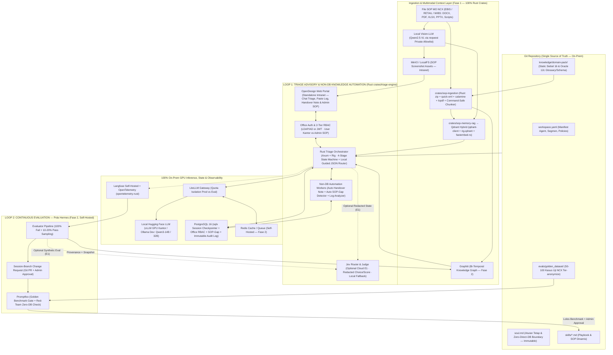

# DESIGN.md — NCX Triage & Internal Self-Evolving Autonomous AI Architecture (Design 2.5 — 100% Pure Rust Backend)

> [!IMPORTANT]
> Dokumen ini merupakan **Design 2.5** (memperbarui Design 2.4 per [ADR-001](docs/adr/ADR-001-hybrid-python-rust-and-jev-orchestrator.md), [ADR-002](docs/adr/ADR-002-internal-siebel16-oracle12c-zero-db-advisory-and-knowledge-automation.md), & [ADR-003](docs/adr/ADR-003-pure-rust-backend-workspace.md)):
> 1. **100% Pure Rust Backend Workspace (`ADR-003`):** Seluruh backend — Modul #1 (`crates/sop-ingestion`), Modul #2 (`crates/sop-memory-rag`), dan Modul #3 (`crates/triage-engine`) — berbagi tipe *compile-time* lewat `crates/sop-core` dalam satu **Cargo Workspace** tanpa runtime Python di server produksi kantor.
> 2. **Zero Direct DB / Zero Prod Server Execution (`ADR-002`):** Khusus internal kantor berbasis **Siebel CRM 16 + Oracle Database 12c**. AI **TIDAK terhubung ke Oracle 12c** (baik `SELECT` maupun `UPDATE/DDL` dilarang) dan **TIDAK mengeksekusi perintah ke server produksi**. AI fokus penuh pada **Advisory ("bagaimana caranya...")**, analisa potongan log yang di-paste user di chat, referensi query/command siap salin, serta **Non-DB Knowledge Automation**.
> 3. **100% Intranet / On-Prem First:** Seluruh stack inti (**Rust Workspace**, **Qdrant**, **vLLM/Ollama**, **MinIO**, **PostgreSQL 16**, **Langfuse**, **OpenDesign Web Portal**) berjalan mandiri di jaringan internal kantor tanpa internet. **Jev (`TypeSafe AI`, Exception `E1`)** bersifat **opsional** (*redacted payload only*) dengan **Local Structured-Output Engine (`vLLM` Guided JSON)** sebagai *primary offline-ready router*.
> 4. **Domain Context Pack (`knowledge/domain-pack/`) & Office 2-Tier RBAC:** Katalog statis Siebel 16 / Oracle 12c (*read-only*) + login user kantor (`User Kantor` vs `Admin SOP`) + *Immutable Audit Log* + *Auto SOP-Gap Detector*.
> 5. **Standalone OpenDesign Web Portal (`opendesign-web-portal`):** Berdiri sendiri di jaringan internal kantor (mis. `ai.ncxall.my.id` / intranet VPS — terpisah penuh dari `https://ncxall.my.id/dashboard`) dengan protokol SSE Streaming.

---

## 1. Tujuan Arsitektur (3 Pilar Utama — 100% On-Prem Pure Rust)

1. **Multimodal SOP & Siebel 16 / Oracle 12c Domain Grounding (Fase 1):** Menyerap dokumen SOP operasional MO NCX (`SOP EBIS`, `SOP RETAIL`, `SOP WIBS` dalam format `.docx`, `.pdf`, `.xlsx`, `.pptx`, `.md`, `.sh`, `.sql`, `.xml`) termasuk *screenshot* konfigurasi *before/after* + **Domain Context Pack** (`knowledge/domain-pack/`) secara native di **Rust** (`zip`, `quick-xml`, `calamine`, `lopdf`, `reqwest` → local `Qwen2.5-VL`) tanpa kontradiksi antar versi.
2. **Deterministic 4-Stage Triage & Non-DB Knowledge Automation (Fase 1 – 1.5):**
   - **Loop 1 (Triage & Advisory):** **Rust Triage Engine (`Axum` + `Rig` + `sqlx`)** dengan *Offline-First Structured Router* (serta **Jev `Choice`** opsional via Exception `E1`) mengunci alur `INTERVIEW → ANALYZE → CONFIRM → VERDICT` agar AI tidak pernah menebak solusi di pesan pertama.
   - **Non-DB Automation:** Auto-ingestion & versioning SOP (`v1 → v2`), analisa potongan log yang di-paste/upload user di chat, **Auto Handover / Escalation Note Generator**, serta **Auto SOP-Gap Detector** ke backlog Admin saat `NO SOP MATCH`.
3. **Continuous Self-Evaluation & Self-Hosted Knowledge Automation (Fase 2 – 3):**
   - **Loop 2 (Pola Hermes — Fase 2):** Evaluasi otomatis terhadap **Golden Benchmark 50–100 Kasus NCX** ([evals/README.md](evals/README.md)) via `Promptfoo` (+ opsi `Jev Score` pada payload sintetis), memori bi-temporal (**Graphiti**), serta usulan perbaikan `skills/*.md` lewat **Session-Branch Git PR** + *Admin Approval*.
   - **Self-Hosted Internal Automation (Fase 3):** Ekstensi automasi *non-DB / non-prod-destructive* yang 100% *self-hosted on-prem* (mis. *scheduled SOP freshness audit*, *knowledge sync*, *drafting report* terjadwal via Kestra/Temporal internal + *Approvals Queue* manusia).

---

## 2. Diagram Arsitektur

### 2.1 Arsitektur Menyeluruh (Design 2.5 — 100% Pure Rust On-Prem Advisory)

<picture>
  <source media="(prefers-color-scheme: dark)" srcset="docs/diagrams/sop-triage-architecture-dark.svg">
  <source media="(prefers-color-scheme: light)" srcset="docs/diagrams/sop-triage-architecture-light.svg">
  
</picture>

> Versi interaktif **Archify** (zoom, pan, dark/light toggle): [`docs/diagrams/sop-triage-architecture.html`](docs/diagrams/sop-triage-architecture.html)

<details>
<summary>Detail Topologi Lengkap (Mermaid Two-Loop Pure Rust Source)</summary>



</details>

### 2.2 Alur Wajib 4-Tahap SOP Triage State Machine (Rust Axum/Rig + Local/Jev Router — Fase 1)

<picture>
  <source media="(prefers-color-scheme: dark)" srcset="docs/diagrams/sop-triage-lifecycle-dark.svg">
  <source media="(prefers-color-scheme: light)" srcset="docs/diagrams/sop-triage-lifecycle-light.svg">
  
</picture>

> Versi interaktif **Archify** (zoom, pan, dark/light toggle): [`docs/diagrams/sop-triage-lifecycle.html`](docs/diagrams/sop-triage-lifecycle.html)

---

## 3. Batasan Arsitektural & Pola Terbaik (Design 2.5)

| Prinsip / Pola | Implementasi di Design 2.5 | Manfaat |
| :--- | :--- | :--- |
| **100% Pure Rust Backend (`ADR-003`)** | 1 Cargo Workspace (`sop-core`, `sop-ingestion`, `sop-memory-rag`, `triage-engine`) tanpa Python runtime | 1 binary statis (< 50 MB RAM idle), *compile-time type safety* lintas modul, mudah di-deploy di intranet tanpa *virtualenv/wheel hell*. |
| **Zero Direct DB / Prod Touch (`ADR-002`)** | Nol driver Oracle 12c (`SELECT`/`UPDATE` dilarang), nol SSH exec ke server Siebel 16 | 0% risiko merusak/membebani database & server produksi kantor; AI aman dipakai seluruh tim operasional. |
| **On-Prem / Intranet First** | Semua layanan inti (`vLLM`, `Qdrant`, `MinIO`, `PostgreSQL`, `Langfuse`, `OpenDesign`) jalan 100% lokal di LAN kantor; **Jev (`E1`)** opsional dengan *local fallback* penuh | Sistem tetap 100% fungsional di jaringan kantor tanpa akses internet keluar (*air-gapped ready*). |
| **Domain Context Pack (`knowledge/domain-pack/`)** | Katalog statis tabel `S_*`/`CX_*`, komponen Siebel 16, kamus NCX, & template referensi | Menjawab *"bagaimana caranya..."* secara presisi tanpa halusinasi sintaks Oracle 12c atau komponen Siebel 16. |
| **OpenDesign Standalone Web Portal** | Portal web mandiri (`opendesign-web-portal`) terpisah penuh dari `ncxall.my.id/dashboard` | Ruang layar penuh untuk Chat Triage, blok CLI/query referensi, pratinjau screenshot SOP, & Panel Admin SOP + SOP-Gap. |

---

## 4. Stack Teknologi Bertahap (100% Pure Rust Backend — Verified GitHub Repos)

### Fase 1 — Multimodal SOP RAG, Advisory Triage & Standalone Portal (Intranet Kantor)
| Lapisan | Komponen / Crate | Repositori Terverifikasi | Peran |
| :--- | :--- | :--- | :--- |
| **Shared Domain Types** | `crates/sop-core` (`serde`, `chrono`, `sha2`, `thiserror`, `schemars`) | `serde-rs/serde`, `dtolnay/thiserror`, `GREsau/schemars` | Kontrak tipe tunggal *compile-time* (`SopMetadata`, `SopChunk`, `ExtractedAsset`, `IngestResult`) dipakai Mod 1, 2, & 3. |
| **Document Ingestion (Mod 1)** | `crates/sop-ingestion` (`zip`, `quick-xml`, `calamine`, `lopdf`, `encoding_rs`, `reqwest`, `clap`) | `zip-rs/zip2`, `tafia/quick-xml`, `tafia/calamine`, `J-F-Liu/lopdf`, `seanmonstar/reqwest` | Parse `.docx`/`.pptx`/`.xlsx`/`.pdf`/skrip & `domain-pack/`, jaga blok CLI/XML/SQL utuh, ekstrak berurutan *screenshot* `before/after` + panggil lokal `Qwen2.5-VL`. |
| **Hybrid Memory & RAG (Mod 2)** | `crates/sop-memory-rag` (`qdrant-client`, `rig-qdrant`, `fastembed`) → **Qdrant** | `qdrant/rust-client`, `0xPlaygrounds/rig`, `Anush008/fastembed-rs`, `qdrant/qdrant` | Pencarian hibrida akurat (`BAAI/bge-m3` + BM25 + `bge-reranker-v2-m3`) + metadata temporal (`doc_version`, `valid_from`, `valid_until`, `is_active`, `segment`, `role_acl`). |
| **State, Auth & Assets** | **PostgreSQL 16** (`sqlx`) + **MinIO** | `launchbadge/sqlx`, `minio/minio` | Checkpointer sesi Rust, Office 2-Tier RBAC (`jsonwebtoken` + `argon2`), *SOP-Gap* log, *Immutable Audit Log*, & penyimpanan gambar SOP. |
| **Triage Engine & Non-DB Auto (Mod 3)** | `crates/triage-engine` (`axum`, `tokio`, `rig-core`, `tower-http`) + Local Guided Router (+ **Jev** opsional `E1`) | `tokio-rs/axum`, `tokio-rs/tokio`, `0xPlaygrounds/rig` | State machine 4-tahap, analisa log paste user, *Auto Handover Note*, *Auto SOP-Gap Detector*, & SSE Streaming API. |
| **Private LLM Gateway** | **LiteLLM** → **Ollama** (dev lokal) / **vLLM** (GPU Server Kantor) | `BerriAI/litellm`, `vllm-project/vllm` | Model Hugging Face privat (`Qwen3-14B/32B` + `Qwen2.5-VL-7B` — lihat [infra/HARDWARE-SIZING.md](infra/HARDWARE-SIZING.md)). |
| **Observability** | **Langfuse** (Self-Hosted) + `opentelemetry-otlp` | `langfuse/langfuse`, `open-telemetry/opentelemetry-rust` | Trace *end-to-end* tiap sesi *triage* & latensi retrieval di intranet kantor. |
| **Frontend UI (Mod 4)** | **OpenDesign** Standalone Web Portal (`web/`) | Standalone di repo ini | Portal Web AI intranet mandiri (terpisah dari `ncxall.my.id/dashboard`): Login Kantor, Chat Triage, Paste Log, Handover Note, & Panel Admin SOP/SOP-Gap. |

### Fase 2 — Hermes Continuous Self-Evaluation & Bi-Temporal Memory (Self-Hosted)
- **Graphiti** (`getzep/graphiti`) untuk *bi-temporal knowledge graph* tersinkron dengan invalidasi Qdrant.
- **Promptfoo** (`promptfoo/promptfoo`) terhadap **Golden Benchmark 50–100 Kasus NCX** ([evals/README.md](evals/README.md)) (+ opsi `Jev Score` pada payload sintetis).
- *Session-Branch Git PR* untuk `skills/*.md` (dilarang *auto-merge*, wajib approval Admin).
- **Redis Cache** (`allkeys-lru`) terpisah dari **Redis Queue** (`noeviction` + AOF).

### Fase 3 — Self-Hosted Knowledge & Workflow Automation (Non-DB)
- **Kestra / Temporal (Self-Hosted)** untuk *scheduled SOP freshness checks*, *batch knowledge audit*, & pelaporan berkala berbasis dokumen/log input (tetap **Zero Direct DB / Zero Prod Touch**).

---

## 5. Mitigasi 7 Celah Kritis (Design 2.5)

1. **Zero Direct DB / Prod Execution (`ADR-002`):** Nol crate driver Oracle 12c & nol SSH runner di `Cargo.toml`; AI hanya memberi referensi query/command siap salin lengkap dengan peringatan verifikasi manual.
2. **Split-Brain Context (SOP Basi):** Satu *ingestion pipeline* Rust (`crates/sop-ingestion`); semua chunk Qdrant wajib membawa `doc_version`, `valid_from`, `valid_until`, `is_active`, `segment`, `role_acl`. Upload revisi otomatis menandai versi lama `is_active=false`.
3. **Multimodal SOP & Siebel/Oracle Blind Spot:** Gambar tertanam diekstrak deterministik dari XML/PDF ke MinIO + dideskripsikan Vision-LLM lokal; ditambah `knowledge/domain-pack/` agar istilah & struktur Siebel 16 / Oracle 12c selalu akurat.
4. **Premature Verdict / Hallucinated Command:** Transisi ke `VERDICT` dikunci oleh *compile-time enum state machine* Rust + *Local Guided JSON* (atau Jev opsional `E1`) dan blok CLI/XML/SQL dilindungi *command-safe chunker* + *Hybrid BM25+Vector*.
5. **Auto-Merge & Judge Gaming (Loop Hermes):** `soul.md` *immutable*; perubahan `skills/*.md` wajib via Git PR + *Golden Benchmark* + *Admin Approval*.
6. **On-Prem Privacy & Optional Cloud Boundary (`E1`):** Default 100% offline/intranet; panggilan Jev opsional dibatasi keras oleh `CONSTRAINTS.md` Exception `E1` (hanya *redacted slot state / synthetic eval*, nol SOP mentah/IP/kredensial).
7. **Indirect Prompt Injection & Blind Observability:** Potongan log yang di-paste user diperlakukan sebagai *untrusted data*; semua sesi & `NO SOP MATCH` tercatat di *Immutable Audit Log* PostgreSQL + `trace_id` OTel ke Langfuse lokal.

---

## 6. Struktur Repositori (`c:/Users/Administrator/LLM`)

```text
LLM/
├── AGENTS.md                   # Peta kerja & harness rules untuk AI coding agent
├── CONSTRAINTS.md              # Kontrak kualitas terukur (Floor + Zero-DB + 100% Rust + E1)
├── DESIGN.md                   # Dokumen ini (Design 2.5 — 100% Pure Rust On-Prem Advisory)
├── PRD.md                      # Product Requirements Document (PRD 2.5)
├── Cargo.toml                  # Rust Cargo Workspace root (dibuat di Phase 4 TDD)
├── feature_list.json           # Pelacakan fitur & bukti verifikasi per slice
├── progress.md                 # Log progres & status terakhir lintas sesi
├── init.ps1 / init.sh          # Skrip baseline health-check Windows & Bash
├── docs/
│   ├── intent/sop-triage-ai.md # Statement of Intent terkonfirmasi
│   ├── adr/                    # ADR-001, ADR-002 (On-Prem Zero-DB), & ADR-003 (Pure Rust)
│   └── diagrams/               # Diagram Archify (Architecture & 4-Stage Lifecycle)
├── knowledge/
│   └── domain-pack/            # Katalog statis Siebel 16, Oracle 12c, & glosarium NCX (Read-Only)
├── spec/
│   ├── capability-map.md       # Peta 4 modul & urutan build (Phase 0)
│   └── SPEC-<module>.md        # Spesifikasi detail per modul (Phase 1)
├── tasks/
│   ├── plan.md                 # Rencana teknis Rust TDD (Phase 2)
│   └── todo.md                 # Daftar tugas vertical-slice Rust TDD (Phase 3)
├── evals/                      # Golden Benchmark 50-100 Kasus NCX (Promptfoo + README)
├── infra/                      # HARDWARE-SIZING.md & Docker Compose On-Prem
├── crates/
│   ├── sop-core/               # Shared Rust domain models & error types
│   ├── sop-ingestion/          # Modul #1: Multimodal Rust parser, chunker, vision, assets, CLI
│   ├── sop-memory-rag/         # Modul #2: Qdrant Hybrid + fastembed + temporal ACL
│   └── triage-engine/          # Modul #3: Axum + Rig 4-Stage Triage, RBAC, Non-DB Auto
└── web/                        # Modul #4: Standalone OpenDesign Intranet Web Portal
```
